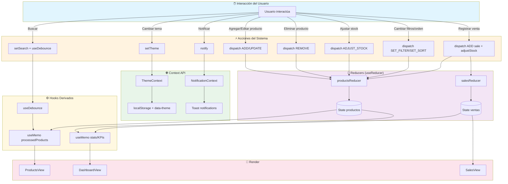
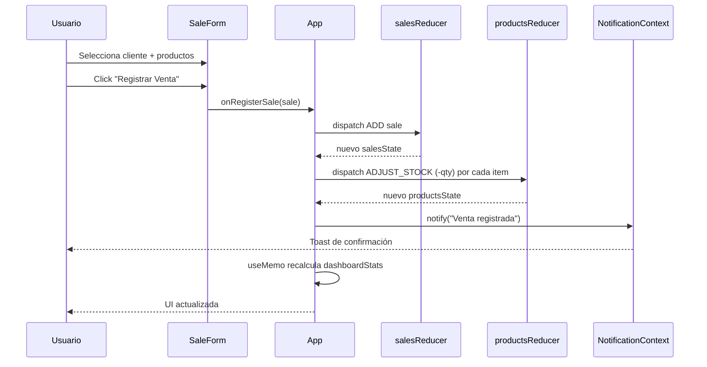

# TechStore Pro — Sistema de Gestión Empresarial

## Descripción del Proyecto

| Módulo           | Descripción                                                      |
| ---------------- | ---------------------------------------------------------------- |
| **Dashboard**    | KPIs del negocio, alertas de stock, top productos y categorías   |
| **Inventario**   | CRUD completo de productos con filtros, orden y paginación       |
| **Ventas**       | Registro e historial de ventas con descuento automático de stock |
| **Clientes**     | Directorio de clientes con búsqueda y registro                   |
| **Preferencias** | Moneda, items por página, umbral de stock, notificaciones        |

**Todos los hooks solicitados en la guía están implementados:**

- ✅ `useReducer` — Estado complejo (productos y ventas)
- ✅ `useState` — Estado local de UI
- ✅ `useContext` — Tema, preferencias y notificaciones
- ✅ `useEffect` — Sync con `localStorage`, cleanup, auto-focus
- ✅ `useMemo` — Cálculos derivados (productos procesados, KPIs)
- ✅ `useCallback` — Handlers estables
- ✅ `useRef` — Auto-focus, timers, scroll
- ✅ Hooks personalizados — `useLocalStorage`, `useDebounce`, `useProducts`

## Diagrama de Flujo de Estado y Ciclo de Render



### Ciclo de Render — Registrar una Venta



---

## Justificación Técnica de Cada Hook

### 1. `useReducer` en lugar de `useState` simple

**Productos**: El estado de inventario tiene 12 productos con 8 propiedades cada uno (SKU, nombre, categoría, precio, costo, stock, stock mínimo, proveedor, estado). Además hay **4 filtros simultáneos** (categoría, stock, estado, orden) y una **búsqueda**. Manejar esto con múltiples `useState` sería inmanejable.
Con `useReducer`, **todo vive en un solo objeto de estado** y cada acción produce un nuevo estado inmutable.

**Ventas**: mismo principio. Cada venta tiene cliente, items (array de productos), total, fecha y estado. El reducer maneja `ADD`, `REMOVE`, `SET_SORT`, `SET_FILTER_STATUS`.

**¿Por qué no `useState`?** Porque necesitamos: (1) centralizar la lógica de negocio en un reducer testeable, (2) garantizar inmutabilidad, (3) tener trazabilidad de acciones (cada `dispatch` es inspeccionable en DevTools), (4) escalar sin refactor.

### 2. `useContext` para tema, preferencias y notificaciones

**Problema resuelto — Prop Drilling:**

```
App
├── Header (necesita theme, formatPrice, lowStockThreshold)
│   └── ThemeToggle (necesita theme, toggleTheme)
├── Sidebar (necesita theme, productsStats)
├── DashboardView (necesita formatPrice)
│   └── KPICard
│   └── LowStockAlert
├── ProductsView (necesita formatPrice, viewMode, itemsPerPage)
│   └── ProductTable (necesita formatPrice)
│   └── ProductForm
└── ...
```

Sin Context, `theme` tendría que pasar por 4-5 niveles de props. Con `useContext`.

**¿Por qué no `useState`?** Porque el tema y las preferencias son **estado global** que múltiples componentes necesitan leer y escribir. Un `useState` local en `ThemeToggle` no permitiría que `Header` reaccione al cambio.

### 3. `useEffect` para sincronización y cleanup

**Sincronización con `localStorage`** (ThemeContext):

```javascript
useEffect(() => {
  localStorage.setItem("techstore-theme", JSON.stringify(theme));
  document.documentElement.setAttribute("data-theme", theme);
}, [theme]);
```

**Cleanup en listeners** (App.jsx, NotificationContext):

```javascript
useEffect(() => {
  const timers = timersRef.current;
  return () => {
    timers.forEach((timer) => clearTimeout(timer));
    timers.clear();
  };
}, []);
```

**Cleanup en `useDebounce`**:

```javascript
useEffect(() => {
  const handler = setTimeout(() => setDebouncedValue(value), delay);
  return () => clearTimeout(handler);
}, [value, delay]);
```

**¿Por qué no `useState`?** Porque `useState` no maneja efectos secundarios. Necesitamos conectar React con APIs del navegador (localStorage, matchMedia, document).

### 4. `useMemo` para cálculos derivados

**`processedProducts`** en App.jsx: aplica 3 filtros + búsqueda + ordenamiento sobre 12+ productos. Sin `useMemo`, esta operación se ejecutaría en **cada render** del componente (incluso al escribir en el buscador o cambiar el tema).

**`dashboardStats`**: calcula KPIs del negocio (ventas hoy, total ventas, stats por categoría, top productos). Solo se recalcula cuando cambian las ventas, los productos o los clientes.

**`stats` en `useProducts`**: valor total del inventario, productos activos, alertas de stock, ganancia potencial.

**¿Por qué no calcular directamente?** Porque cada render dispararía el cálculo. Con `useMemo`, React solo lo recalcula cuando las dependencias cambian, mejorando el rendimiento medible en React DevTools Profiler.

### 5. `useCallback` para handlers estables

**Todos los handlers que se pasan como props a componentes hijos** están memorizados:

```javascript
const handleAddProduct = useCallback(
  (payload) => {
    products.addProduct(payload);
    notify(`Producto "${payload.name}" agregado`, "success");
  },
  [products, notify],
);
```

**¿Por qué no definir inline?** Cada render crea nuevas instancias de funciones. Si el hijo recibe `onClick={handleAddProduct}`, React considera que la prop cambió y re-renderiza el hijo innecesariamente. Con `useCallback`, la referencia se mantiene estable entre renders.

**Sin overuse**: no se usa `useCallback` en funciones que no se pasan a hijos (por ejemplo, `handleChange` dentro de `ProductForm`, `handleAddItem` dentro de `SaleForm`), porque no aportan beneficio.

### 6. `useRef` para acceso DOM y valores mutables

**Auto-focus** en `ProductForm` y `SaleForm`:

```javascript
useEffect(() => {
  if (showForm && formTitleRef.current) {
    formTitleRef.current.focus();
  }
}, [showForm]);
```

**Timers en `NotificationContext`** — sin disparar re-renders:

```javascript
const timersRef = useRef(new Map());
// ...
timersRef.current.set(id, timer);
```

**Scroll al cambiar de vista** en App.jsx:

```javascript
const mainRef = useRef(null);
useEffect(() => {
  mainRef.current?.scrollTo({ top: 0, behavior: "smooth" });
}, [activeView]);
```

**¿Por qué no `useState`?** Porque cambiar `titleInputRef.current` o `timersRef.current` **no debe disparar un re-render**. Son valores mutables que persisten entre renders sin afectar la UI.

### 7. Hook personalizado `useLocalStorage`

Encapsula lectura inicial, escritura, sincronización entre pestañas y manejo de errores:

```javascript
const [currency, setCurrency] = useLocalStorage("techstore-currency", "PEN");
const [itemsPerPage, setItemsPerPage] = useLocalStorage(
  "techstore-items-per-page",
  8,
);
const [lowStockThreshold, setLowStockThreshold] = useLocalStorage(
  "techstore-low-stock-threshold",
  5,
);
```

**Reutilizable**: se usa 5+ veces en `PreferencesContext` con diferentes claves y valores por defecto.

**¿Por qué no `useState` directamente?** Porque necesitamos persistencia automática, `JSON.stringify`/`parse`, y sincronización entre pestañas con el evento `storage`.

### 8. Hook personalizado `useDebounce`

Retrasa la actualización del término de búsqueda 300ms, evitando recalcular `processedProducts`, `processedSales` y `filteredClients` en cada tecla:

```javascript
const debouncedProductSearch = useDebounce(products.state.searchTerm, 300);
```

**¿Por qué es necesario?** Con 12+ productos y filtros complejos, cada tecla dispararía el filtrado completo. `useDebounce` optimiza la experiencia de usuario.
